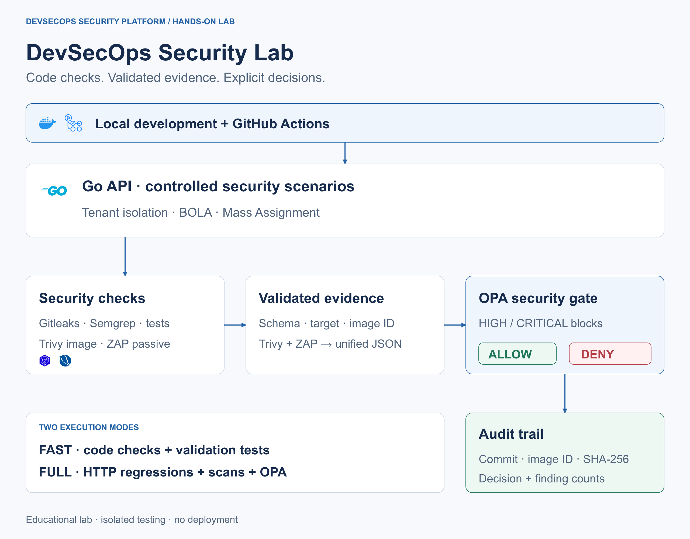

# DevSecOps Security Platform

[](https://github.com/magododevops/devsecops-security-platform/actions/workflows/security-ci.yml)
[](https://github.com/magododevops/devsecops-security-platform/actions/workflows/security-reusable.yml)

A DevSecOps laboratory that turns security checks into **validated evidence and explicit policy decisions**. A single Go API demonstrates tenant authorization, controlled vulnerabilities, portable scanner orchestration, and a fail-closed OPA gate.

The same Makefile and scripts run locally and in a reusable GitHub Actions workflow. The repository implements checks and audit evidence; it does not deploy or promote an application. Workflow badges reflect GitHub's reported status, not a claim that every scanner has passed.

## Lab overview



[Edit in Draw.io](docs/architecture/lab-overview.drawio) · [Full-size PNG / sharing](docs/architecture/lab-overview.png) · [Technical architecture and pipeline](docs/architecture/README.md)

This presentation view summarizes the implemented lab; it is not an execution trace or a scan result. See the technical diagrams for stage order and failure behavior.

## Technology stack

| Layer | Implemented technology and scope |
|---|---|
| Application | Go `net/http`, in-memory work orders, OpenAPI contract |
| Execution | Make, Bash, Docker; Python for evidence processing |
| CI | GitHub Actions: manual dispatcher and reusable workflow |
| Secrets / SAST | Gitleaks and Semgrep through pre-commit; repository-local Semgrep rules |
| Vulnerabilities / configuration | Trivy image scanning; standalone dependency and IaC fixtures |
| DAST | OWASP ZAP passive API scan in an internal Docker network |
| Policy | OPA with Rego unit tests and default-deny evaluation |
| Audit | JSON reports, SHA-256 evidence hashes, image identity checks, CI artifacts |

Syft/SBOM generation, DefectDojo ingestion, and Docker Compose orchestration are not implemented.

## How the Security Gate works

See the [detailed security pipeline](docs/architecture/README.md#security-pipeline) for the execution flow, FAST/FULL branches and failure boundaries.

1. **Check code and behavior.** Gitleaks, Semgrep, Go unit tests and Rego tests run through `make check`. FULL adds BOLA and Mass Assignment HTTP regressions.
2. **Collect fresh reports.** FULL builds and scans `devsecops-go-api:lab` with Trivy, then runs ZAP against `http://go-api:8080`. Expected previous report files are removed before scanning; copies are stored in a unique run directory.
3. **Validate before trusting.** Raw JSON must identify the expected image and API target and contain the required structures. Trivy's image ID must match the locally inspected Docker image ID.
4. **Normalize and merge.** ZAP findings and Trivy image findings become `unified-evidence.json`. Informational ZAP alerts stay in the raw report and are excluded from normalized findings.
5. **Decide with OPA.** The policy requires `scan_status: "success"`, `findings_complete: true`, and a valid findings array. Any **HIGH or CRITICAL** finding denies the gate. Valid input with only UNKNOWN, LOW or MEDIUM findings, or an empty array, is allowed. Missing, invalid or incomplete input denies evaluation.
6. **Record the decision.** After gate evaluation, the pipeline attempts to write and validate `manifest.json`. ALLOW then exits successfully; DENY exits nonzero. Earlier execution or validation failures abort before this stage and can leave no manifest.

Gitleaks and Semgrep enforce their own exit statuses; their findings are not merged into the OPA input. Trivy collects findings with `--exit-code 0`, leaving severity enforcement to OPA. ZAP finding statuses 0/1/2 are accepted for further validation; execution errors or missing reports stop the pipeline.

## FAST vs FULL

| Behavior | FAST CI (default) | FULL CI |
|---|---|---|
| Pre-commit configuration validation | Yes | Yes |
| Gitleaks, Semgrep, Go unit tests, Rego tests | `make check` | Baseline, then repeated by the unified pipeline |
| Evidence-validation and image-identity unit tests | Yes | Yes |
| BOLA / Mass Assignment HTTP regressions | No | Yes |
| Trivy image scan + passive ZAP | No | Yes |
| Unified OPA gate + audit manifest | No | Yes, if prior stages complete |
| Evidence artifact upload | No | Attempted even on failure; 7-day retention |

Run [Security CI](https://github.com/magododevops/devsecops-security-platform/actions/workflows/security-ci.yml) using **Run workflow → fast/full**. The dispatcher uses `workflow_dispatch`; there are no automatic push or pull-request triggers. The reusable workflow accepts `run_full_pipeline` and uses read-only repository permissions.

Locally, `make check` is the fast baseline. It does not include the additional Python validation unit tests that FAST CI runs. `make security-pipeline` runs the unified FULL script, without CI setup or artifact upload.

## API security scenarios

The work-order API uses synthetic bearer identities (`lab-alice`, `lab-bob`) and two tenants. Vulnerable behavior requires **both** `LAB_ISOLATED=1` and the matching `LAB_SCENARIO`; that flag is an application switch, not network isolation enforcement.

| Scenario | Secure behavior | Controlled vulnerable behavior |
|---|---|---|
| BOLA: `GET /v1/work-orders/WO-2001` as Alice | Tenant-scoped lookup returns 404 | `LAB_SCENARIO=bola` omits the tenant check and returns the other tenant's order |
| Mass Assignment: PATCH Alice's order with `tenant_id` | A strict status-only request object rejects unknown fields with 400 | `LAB_SCENARIO=mass-assignment` binds client fields into the domain object and permits tenant reassignment |

`make api-regression` tests secure defaults, scenario selection without isolation, and explicitly enabled vulnerable behavior in internal Docker networks. These are executable expected behaviors, not reported results from a run in this documentation update.

The passive ZAP scan does not configure bearer authentication and does not prove tenant or property authorization. Those controls are exercised by the Go and HTTP regression tests. `LAB_INSECURE_HEADERS=1` separately enables a header-disclosure demonstration for DAST experimentation.

## Evidence, audit and remediation

FULL writes per-run evidence under `reports/pipeline/run-*/`:

| File | Purpose |
|---|---|
| `trivy-image.json` | Raw image vulnerability report |
| `zap-api.json` | Raw passive API scan report |
| `zap-normalized.json` | Normalized, non-informational ZAP findings |
| `unified-evidence.json` | Trivy + ZAP policy input |
| `manifest.json` | Commit, dirty state, Docker image ID, evidence hashes, finding counts and decision |

ZAP also produces JSON/HTML under `reports/zap/`. Reports are gitignored. FULL CI attempts to upload the run directories and ZAP reports as `security-evidence-<run_id>`, including when an earlier step fails. Missing files generate an artifact warning; upload does not prove a complete run.

To remediate a denial, inspect the raw report for package, rule and request details, update the affected code or image, and rerun the relevant checks followed by FULL. A malformed report requires fixing evidence collection, not lowering the severity threshold. The pipeline does not implement exception approval, ticket creation, deduplication or centralized vulnerability management.

## Run locally

Use a Linux/WSL shell from the repository root with Git, GNU Make, Bash, a working Docker daemon, Python 3, `jq`, pre-commit and a Trivy CLI available. Python 3.12, pre-commit 4.3.0 and Trivy 0.76.2 are selected in CI. The Makefile pins Go and OPA container images; Go runs in Docker, so a host Go installation is not required. Registry access and scanner database downloads are needed.

```bash
# Install hooks and run their baseline checks
make setup

# Fast baseline and evidence-processing unit tests
make check
make evidence-test
python3 -m unittest discover -s tests/integration -p 'test_audit_evidence.py' -v

# Controlled authorization regressions (builds the Go image)
make api-regression

# Full collection, evidence validation, OPA decision and audit manifest
make security-pipeline
```

Useful individual commands:

```bash
make go-test
make opa-test
make trivy-sca       # Dependency fixture, outside the unified pipeline
make trivy-iac       # Container configuration fixtures, outside the unified pipeline
make trivy-image    # Builds and scans the Go image
make zap            # Requires the Go image to have been built first
make opa-gate REPORT=reports/pipeline/run-XXXXXXXX/unified-evidence.json
make lab-clean
```

Replace `run-XXXXXXXX` with an actual generated directory. `make help` lists additional targets. The DAST regression targets require saved `zap-secure.json` and `zap-insecure.json`; those fixtures are not produced by a standard FULL run. Run one lab pipeline at a time: scripts use fixed image, container, network and report names. Cleanup preserves reports.

## Repository structure and decisions

```text
.github/workflows/        Manual dispatcher and reusable security workflow
apps/vulnerable-go-api/   Go API, unit tests, Dockerfile and OpenAPI contract
scripts/security/        Scanning, validation, normalization, OPA and audit CLI
security/policies/       Rego security gate
security/rules/          Local Semgrep rules for Go and Python
tests/                   Policy, evidence-processing and HTTP regression tests
examples/                Standalone dependency and container security fixtures
docs/architecture/       Editable Draw.io diagrams and PNG previews
docs/adr/                Architectural decision records
reports/                 Generated evidence; ignored by Git
```

[ADR-0001](docs/adr/0001-security-architecture.md) establishes modular tooling and provider-independent policy. Some capabilities in that decision, such as self-hosted vulnerability management, remain architectural intent. [ADR-0002](docs/adr/0002-single-lab-application.md) limits the end-to-end application target to Go; Python, Bash and Rego support the platform.

The key implemented choices are a shared local/CI execution interface, isolated Docker test networks, a non-root scratch application image, validated JSON before policy evaluation, and a manifest that ties a decision to evidence hashes and local image identity.

## Limitations and security considerations

- This is an educational lab. Use only isolated, authorized environments; never expose vulnerable scenarios publicly or substitute real credentials for synthetic identities.
- Demo bearer tokens and in-memory state are not production authentication or persistence. The mutable in-memory store has no synchronization for concurrent writes.
- Scanner coverage is bounded: Semgrep uses a small local rule set; FULL scans image vulnerabilities and a passive API baseline. Standalone SCA/IaC fixtures do not extend FULL coverage automatically.
- The manifest is unsigned. Hashes support integrity checking against a trusted manifest, not tamper-proof provenance. The image identity check binds Trivy to a local image; it is not an attestation of the running DAST container.
- OPA approval means the configured input satisfies this policy, not that the application is vulnerability-free. UNKNOWN and MEDIUM findings are allowed by the current policy.
- Some dependencies use mutable references, including ZAP's `stable` image tag and major-version GitHub Actions tags. Tool availability, database freshness and network access affect reproducibility.
- No deployment, image signing, registry admission enforcement, automated remediation, SBOM generation or vulnerability-management integration is implemented.
