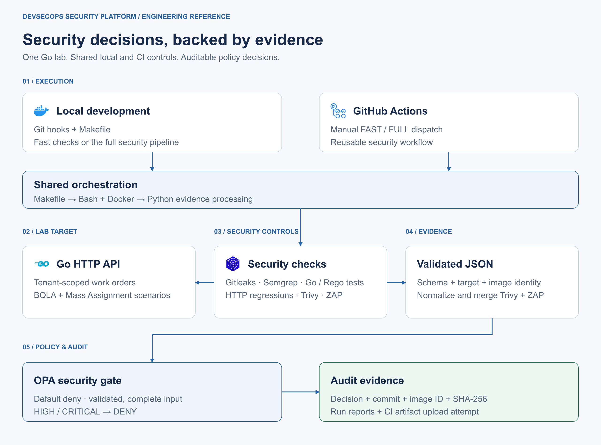
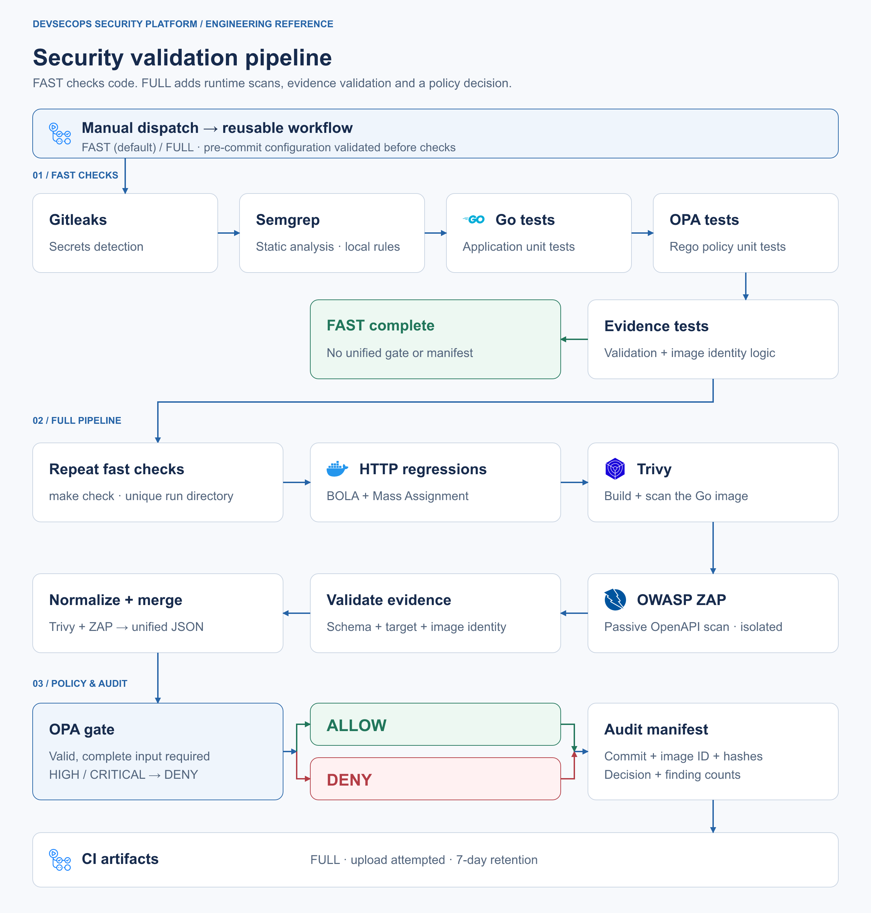

# Architecture diagrams

The [main README](../../README.md#lab-overview) uses a presentation view of the lab. This page contains the two detailed technical views.

| View | Editable source | GitHub preview |
|---|---|---|
| Lab presentation | [lab-overview.drawio](lab-overview.drawio) | [PNG](lab-overview.png) |
| System overview | [architecture-overview.drawio](architecture-overview.drawio) | [PNG](architecture-overview.png) |
| Security execution | [security-pipeline.drawio](security-pipeline.drawio) | [PNG](security-pipeline.png) |

## System architecture

[Edit in Draw.io](architecture-overview.drawio) · [Full-size PNG](architecture-overview.png)

## Security pipeline

[Edit in Draw.io](security-pipeline.drawio) · [Full-size PNG](security-pipeline.png)

## Presentation and sharing

`lab-overview` is the concise project view shared by the root README and social posts. The Draw.io canvas is 1280 × 1000; the opaque-background PNG is exported at 2560 × 2000. Use the PNG when publishing the image on LinkedIn. No publication has been made automatically.

The presentation groups capabilities rather than showing execution order. Only Trivy image and ZAP findings feed the unified OPA input; Gitleaks and Semgrep block through their own checks. The audit trail describes a pipeline capability, not a successful execution: earlier failures can prevent manifest creation. The detailed views and root README explain these boundaries.

## Editing and export

Open a `.drawio` file in [diagrams.net](https://app.diagrams.net/) using **File → Open from → Device**, or use Draw.io Desktop. Shapes, labels and connectors are native editable objects; technology icons are embedded SVGs. The Draw.io source embeds its technology icons; PNG previews are self-contained raster images.

After editing, export the corresponding PNG at 2× scale with a white/light opaque background and no cropping of the full canvas. Verify text and connectors at README width. Update the `.drawio` and `.png` together; SVG preview files are not kept in the repository. The PNG dimensions are 2560 × 2000 for `lab-overview`, 2560 × 1896 for `architecture-overview`, and 2560 × 2680 for `security-pipeline`.

Blue indicates execution or policy flow; green indicates allowed/completed paths or audit outputs; red indicates denial; amber highlights failure boundaries. Dashed connections are reserved for optional relationships. All displayed flows refer to implemented behavior, not deployment plans.

## Sources of truth

- [Manual dispatcher](../../.github/workflows/security-ci.yml) and [reusable CI](../../.github/workflows/security-reusable.yml)
- [Makefile](../../Makefile) and [unified pipeline](../../scripts/security/security-pipeline.sh)
- [ZAP execution](../../scripts/security/zap-api-scan.sh) and [Trivy execution](../../scripts/security/trivy-scan.sh)
- [Raw validation](../../scripts/security/validate-evidence.py), [normalization](../../scripts/security/normalize-zap.py), [merge](../../scripts/security/merge-evidence.py) and [audit](../../scripts/security/audit-evidence.py)
- [Gate wrapper](../../scripts/security/security-gate.sh) and [Rego policy](../../security/policies/security-gate.rego)

The overview groups responsibilities; the pipeline view shows execution order. Gitleaks/Semgrep enforce their own checks, while only Trivy image and ZAP findings reach the unified OPA input. Early errors can prevent manifest creation. CI artifact upload is attempted separately with `always()` for FULL runs.

## Embedded technology icons

Icons come from [Simple Icons](https://simpleicons.org/), a curated brand SVG collection distributed under [CC0](https://github.com/simple-icons/simple-icons/blob/develop/LICENSE.md). Brand marks remain subject to their respective owners' trademark policies. The original SVG payloads are embedded in each diagram; these source URLs are attribution links, not rendering dependencies.

| Technology | Source SVG |
|---|---|
| GitHub Actions | [githubactions](https://cdn.simpleicons.org/githubactions) |
| Go | [go](https://cdn.simpleicons.org/go) |
| Docker | [docker](https://cdn.simpleicons.org/docker) |
| Trivy | [trivy](https://cdn.simpleicons.org/trivy) |
| OWASP ZAP | [zap](https://cdn.simpleicons.org/zap) |

OPA, Gitleaks and Semgrep use editable text labels. The diagrams intentionally avoid improvised brand marks.
